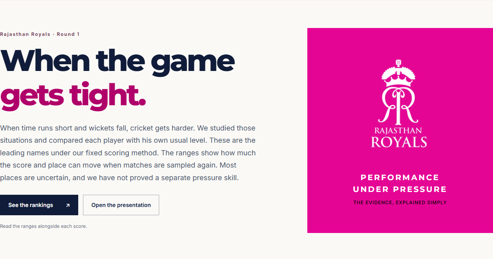

<p align="center"></p>

<h1 align="center">PressureIndex</h1>

<p align="center">How players performed in difficult T20 situations, with uncertainty shown.</p>

<p align="center"><a href="https://charming-brioche-bd8fe4.netlify.app/"><strong>Explore the dashboard</strong></a> · <a href="report/RR_Pressure_Reliability_Methodology.pdf"><strong>Read the report</strong></a> · <a href="presentations/RR_Pressure_Reliability_Presentation.pptx"><strong>Open the slides</strong></a> · <a href="outputs/rankings_final.csv"><strong>See the rankings</strong></a></p>

<p align="center">Rajasthan Royals · SupeRR Selector Season 2 · Round 1<br>10 batters + 10 bowlers · 20-page report · Evidence build 2026-11-18</p>



## Start here

This project studies difficult match situations, then compares each player with his own ordinary-pressure performance. The result is an index centred at **50**, accompanied by score ranges, rank ranges and repeat-check frequencies. It is evidence from recorded matches, not a forecast or proof of a special pressure skill.

Choose the route that suits you:

- **Have one minute?** [Open the live dashboard](https://charming-brioche-bd8fe4.netlify.app/) and explore the two top-ten lists.
- **Reviewing the submission?** [Read the 20-page PDF](report/RR_Pressure_Reliability_Methodology.pdf). Pages 1–12 tell the story; pages 13–20 contain the technical appendix.
- **Want editable slides?** [Open the PowerPoint](presentations/RR_Pressure_Reliability_Presentation.pptx).
- **Need the exact order and values?** [Use the final ranking CSV](outputs/rankings_final.csv). It is the ordering authority.
- **Want the method?** [Follow the calculation](docs/METHOD.md) or [inspect the code map](docs/CODE_GUIDE.md).
- **Want the journey?** [Read how the analysis was built and challenged](docs/PROJECT_JOURNEY.md).
- **Want to run it?** [Preview or verify the public edition](docs/REPRODUCIBILITY.md).

**On this page:** [Method](#the-method-in-cricket-terms) · [Data](#the-six-datasets) · [Evidence](#what-the-evidence-supports) · [Project map](#project-map) · [Run locally](#run-locally) · [Glossary](#glossary)

## The method in cricket terms

1. **Rebuild the situation before each ball.** Work out how much time and how many wickets remain, the scoring demand, and whether the match is a knockout.
2. **Label the hard situations.** Combine those inputs into one pressure score. The highest quarter within each innings type is the high-pressure group.
3. **Compare the player with himself.** Use separate ordinary-pressure balls as his baseline. Adjust for observed competition, innings stage, venue and opposition context.
4. **Be cautious with noisy evidence.** Pull uncertain gains toward zero, combine the declared components, and repeat whole-match draws to show how much scores and places can move.
5. **Apply the selection constraints after scoring.** All players remain in the population fit; exclusions change the displayed candidate pool, not anyone else's rating.

Only Tier 1 players appear in the final lists: at least **200 pressure legal balls**, **400 ordinary legal balls**, and **10 matches in each state**. The final lists contain ten players per discipline and are never padded. Index levels should be compared within a discipline.

[Read the formulas, cutoffs and uncertainty method →](docs/METHOD.md)

## The six datasets

The supplied pack contains **200,999 delivery records across 883 matches**. After quality checks and the historical-benchmark warm-up, the pressure analysis uses **790 matches and 180,482 legal balls**.

- **Ball-by-ball:** what happened, and the information needed to reconstruct the situation before it happened.
- **Matches:** dates, venue IDs, knockout context and result checks.
- **Competitions:** formats, seasons and the IPL, T20I and emerging-team T20 classes.
- **Teams:** consistent team identities and opposition labels.
- **Player mapping:** one consistent identity across files, using player IDs.
- **Playing XIs:** participation checks and the latest observed team labels in the pack.

Match, competition, team and player IDs connect the files. Speed, stroke and delivery-style labels are not rating inputs. Batting positions and pace/spin describe observed roles.

**Data boundary:** the public edition includes the published results, dashboard source and analytical reference code. The proprietary raw pack, private fit caches and identity/selection audits stay outside it. A statistical refit needs licensed inputs and the complete private evidence layer.

[See the dataset counts, used fields and join keys →](docs/DATA_GUIDE.md)

## What the evidence supports

The difficult situations show the clearest change in dismissal risk. That does **not** establish a separate pressure advantage:

- The initial check required 2 clear rate changes; only 1 met the declared cutoff. The check did not pass, and that limitation remains visible.
- After comparing the same innings and stages, all six overall change ranges still include no change.
- Mixing the pressure labels kept much of the order. This weakens the case for a distinct pressure skill.
- Exact places can move substantially; match splits and season comparisons show limited stability.

The report shows the inconvenient results as well as the useful ones. Ratings, intervals and repeat frequencies are conditional on fixed model settings. The rank ranges and top-ten repeat frequencies use the earlier comparison pool; selection exclusions do not trigger a refit.

Pakistani and Bangladeshi national-team players were outside the candidate pool by the team's choice.

Only aggregate exclusion counts are published. Unknown nationality is not guessed from a name. Observed role profiles describe the records, not future team needs.

[Read the validation and limitations →](docs/EVIDENCE_GUIDE.md)

## Project map

- [Report](report/RR_Pressure_Reliability_Methodology.pdf) — the complete visual methodology and technical appendix.
- [Presentation](presentations/RR_Pressure_Reliability_Presentation.pptx) — editable version of the same story and evidence.
- [Final rankings](outputs/rankings_final.csv) — twenty ordered names, scores, ranges, exposure and repeat frequencies.
- [Diagnostic results](docs/EVIDENCE_GUIDE.md#evidence-files) — separation, stability, sensitivity, label mixing and quarantine.
- [Frontend](dashboard/src/App.tsx) — rankings, player details, comparison, evidence and explanations.
- [Analytical source](docs/CODE_GUIDE.md) — where the data, pressure, rating and diagnostic calculations live.
- [Project journey](docs/PROJECT_JOURNEY.md) — the decisions, checks and revisions behind the result.
- [Reproducibility](docs/REPRODUCIBILITY.md) — what runs publicly and what requires the licensed inputs.
- [Data and asset rights](docs/RIGHTS_AND_DATA.md) — the boundary around proprietary data and supplied branding.

## Run locally

For the public review edition, Python's standard library is enough:

```text
python review.py check
python review.py serve
```

Then open `http://127.0.0.1:8455`. The preview uses the packaged public website and does not fit a model.

To work on the frontend source:

```text
npm --prefix dashboard ci
npm --prefix dashboard run dev
```

The original study passed **322/322 automated checks**, including ordering, frozen-score, public-identity and responsive checks. Public-edition verification checks the published snapshot; it does not rerun the private statistical pipeline.

[Full setup and reproduction notes →](docs/REPRODUCIBILITY.md)

## Glossary

**Index** — Our summary score. 50 is neutral; higher means stronger evidence under this fixed method. It is not a forecast.

**Baseline** — The same player's usual level on ordinary-pressure balls. Those balls are kept separate from his pressure balls.

**Shrinkage** — A caution step: when the evidence is noisy, estimated gains are pulled back toward zero.

**Tier** — A minimum evidence rule. Only Tier 1 is ranked; Tier 2 estimates stay in a reference CSV.

**Interval** — A range from repeating the match samples with the settings held fixed. The middle 95% of results is shown; other uncertainty remains. Rank ranges and top-10 frequencies use the frozen original pool.

**Fragile rank** — A place that needs caution: the score range includes 50, the rank range spans more than 10 places, or a top-10 player stays there in fewer than 50% of repeats.

**Shuffled-label check** — keep the cricket results, mix which balls carry the pressure label within the same match, innings and stage, and score again. Similar results after the mix weaken evidence for a separate pressure advantage. The formal name is a placebo test.

---

[Dashboard](https://charming-brioche-bd8fe4.netlify.app/) · [Report](report/RR_Pressure_Reliability_Methodology.pdf) · [Slides](presentations/RR_Pressure_Reliability_Presentation.pptx) · [Rankings](outputs/rankings_final.csv) · [Journey](docs/PROJECT_JOURNEY.md) · [Repository](https://github.com/SuryaThejas-07/RR) · [Back to top](#pressureindex)
